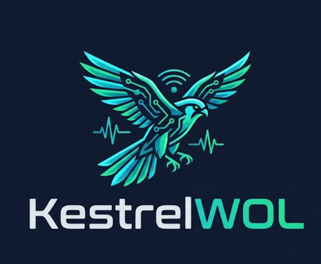

<div align="center">



# KestrelWOL
### Industrial Remote Power, Network Fleet Management & Subnet Automation

[](https://www.python.org/)
[](https://microsoft.com)
[](#)
[](#)
[](#)
[](LICENSE)
[](LICENSE)

<br/>

> **KestrelWOL** es una plataforma moderna, industrial y estricta para el control de energía remoto, encendido masivo programado (Wake-on-LAN) y telemetría de flotas informáticas en redes corporativas sin conexión a Internet (*Air-Gapped / Offline-First*).

</div>

---

## 📊 Comparativa de Características (Features)

| Funcionalidad / Aspecto Clave | 🦅 KestrelWOL | ◽ Otras herramientas WOL genéricas |
| :--- | :---: | :---: |
| **Protección eléctrica escalonada (anti inrush-current 250ms)** | ✔️ | ❌ |
| **Auditoría forense inmutable con SHA-256 encadenado** | ✔️ | ❌ |
| **Acceso directo en 1-clic a RDP (`mstsc`) y consola SSH** | ✔️ | ❌ |
| **Apagado y reinicio remoto controlado con aviso (30s)** | ✔️ | ❌ |
| **Programador semanal desatendido con System Tray** | ✔️ | 〰️ |
| **Agrupación y filtrado inteligente por zonas** | ✔️ | ❌ |
| **Importación/Exportación CSV segura (anti-fórmulas)** | ✔️ | ❌ |

---

## 💻 Instalación y Uso Rápido

### Requisitos del Sistema
- **Sistema Operativo**: Windows 10, Windows 11 o Windows Server (x64 / ARM64).
- **Entorno de Ejecución**: Python 3.10 o superior (el lanzador lo instala automáticamente si falta).

### 🚀 Lanzamiento en 1 Clic (Recomendado)
Haz doble clic en el archivo **`run.bat`**. Comprobará las dependencias necesarias e iniciará la interfaz gráfica directamente.

```cmd
# Lanzamiento directo desde CMD o PowerShell:
run.bat
```

### 📦 Ejecución Manual
```bash
# 1. Clonar o descargar el repositorio
cd WakeOnLanResetXr-main

# 2. Instalar dependencias en el entorno
pip install -r requirements.txt

# 3. Iniciar la aplicación
python main.py
```

> **Consejo para entornos sin consola**: Puedes iniciar el lanzador silencioso de Windows haciendo doble clic en **`gui.pyw`** para ocultar cualquier ventana de terminal en segundo plano.

---

## ⌨️ Utilidad de Línea de Comandos (CLI Headless)

KestrelWOL incluye una CLI desacoplada ideal para scripts de mantenimiento programado en el Programador de Tareas de Windows (*Task Scheduler*):

```bash
# Encender todos los equipos registrados con protección anti-inrush
python cli.py --all

# Encender únicamente los puestos pertenecientes a una sala o zona
python cli.py --zone "Oficina A"

# Ajustar el retardo eléctrico escalonado (ejemplo: 0.5 segundos)
python cli.py --all --delay 0.50

# Listar el inventario de dispositivos en terminal
python cli.py --list

# Escanear puertos y servicios abiertos en un host (RDP, SSH, WEB, VNC)
python cli.py --check-services <IP_EQUIPO>

# Ordenar un apagado o reinicio preventivo remoto (30s)
python cli.py --shutdown <IP_EQUIPO>
python cli.py --reboot <IP_EQUIPO>

# Exportar o importar masivamente la base de datos a CSV
python cli.py --export-csv "inventario.csv"
python cli.py --import-csv "inventario.csv"
```

---

## 🧪 Pruebas y Verificación del Sistema (Test Suite)

Para que desarrolladores y administradores puedan validar de forma instantánea la integridad de la aplicación y sus componentes sin dependencias adicionales:

```bash
# Ejecutar la suite completa con reporte formateado (< 1 segundo)
python tests/run_tests.py

# O mediante el descubridor estándar de Python:
python -m unittest discover tests
```

### Componentes Verificados en la Suite:
- **Red y WOL (`test_wol_service.py`)**: Sanitización regex de IPv4 y MAC, generación exacta del Magic Packet (102 bytes) y emisión UDP.
- **Auditoría Forense (`test_audit_service.py`)**: Encadenamiento criptográfico SHA-256 (*hash chaining*) y consistencia anti-manipulación.
- **Almacenamiento y CSV (`test_storage_service.py`)**: Normalización canónica de zonas y neutralización de inyecciones de fórmulas CSV (CWE-1236).
- **Programador Horario (`test_scheduler_service.py`)**: Coincidencia de horas/días semanales y prevención de disparos duplicados.
- **Detección de Sistema (`test_system_service.py`)**: Lectura de tabla ARP, filtrado de broadcasts/multicasts y exclusión de hosts ignorados.

---

## 💬 Contacto

Para consultas generales, propuestas de mejora o reportes de seguridad relacionados con **KestrelWOL**, puedes comunicarte directamente a través de:

- **Consultas generales y soporte**: [a2carcruzinfo@gmail.com](mailto:a2carcruzinfo@gmail.com)
- **Reportes de vulnerabilidades y seguridad**: [a2carcruzinfo@gmail.com](mailto:a2carcruzinfo@gmail.com)

---

## 📜 Licencia y Atribución

Este proyecto es software libre y de código abierto bajo los términos de la **Licencia MIT**. Puedes consultar el texto íntegro en el archivo [LICENSE](LICENSE).

> **Aviso**: Cualquier redistribución o uso de este código debe preservar el aviso de copyright original y la atribución a los autores del proyecto.
